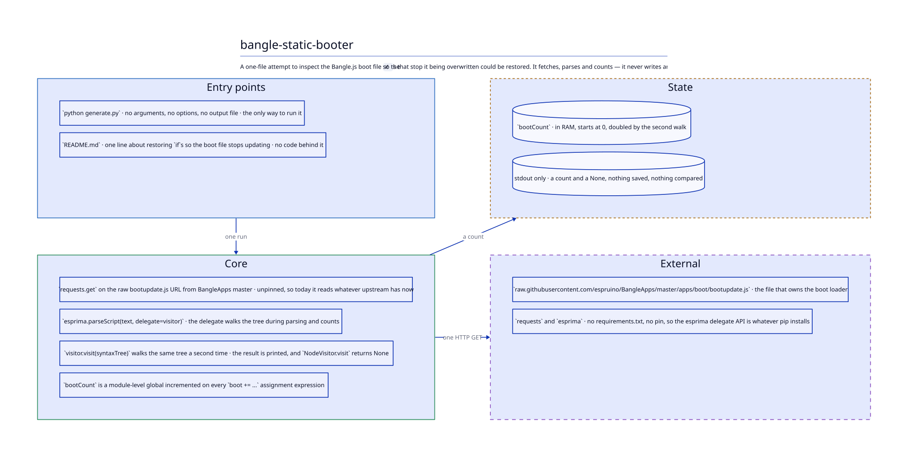

# bangle-static-booter

A 28-line scratchpad that downloads BangleApps' `bootupdate.js`, counts the `boot += ...` statements in it, and prints the number. The rewrite it was written for was never implemented.

Read it left to right:

- **The README promises a fix; the code only counts.** Nothing rewrites `bootupdate.js`, nothing is written to disk, nothing is compared against the watch. The script ends in two `print()` calls, and one of them prints `None`.
- **The count is doubled.** `esprima.parseScript(updateFile, delegate=visitor)` already walks the tree and increments `bootCount` during parsing; then `visitor.visit(syntaxTree)` walks the same tree a second time. Because `bootCount` is a module global and `generic_visit` reaches every node, the printed number is two times the real number of `boot +=` statements — which is the only number the tool produces.
- **It reads a moving target.** The URL is `raw.githubusercontent.com/espruino/BangleApps/master/apps/boot/bootupdate.js`, unpinned, so it inspects whatever upstream ships today rather than the file it was written against in October 2021.
- **Nothing pins the parser.** There is no `requirements.txt`, and the `delegate=` argument is the old esprima-python API — install a newer release and the script fails before it prints anything.
- **Four commits, one day.** All on 2021-10-02, then abandoned; no `.gitignore`, no tests, no output format. Treat it as a note about how the boot file works, not as a tool.

Diagram source: [`docs/system.d2`](docs/system.d2) · renderer: [`scripts/render-diagram.sh`](scripts/render-diagram.sh).
